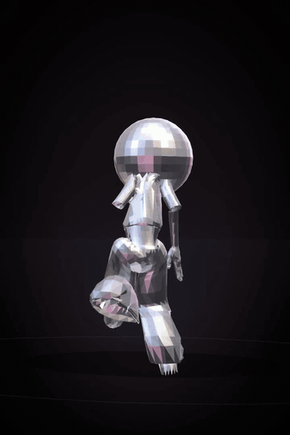

# Music2Dance

Generate dancing skeletons — and a 3D character — from any music track.

**Author:** [Emma Genthon](https://github.com/Emma5099) · genthonemma@gmail.com  
**Weights:** [Emma5099/dance2music](https://huggingface.co/Emma5099/dance2music) (epoch 250)

<p align="center">
  
</p>

```
Audio → mel / onset / beat → Music2PoseTransformer → poses → skeleton + 3D character
```

## Quick start

```bash
git clone https://github.com/Emma5099/Music2Dance
cd Music2Dance
pip install -r requirements.txt

# Download pretrained weights
huggingface-cli download Emma5099/dance2music pytorch_model.pt --local-dir checkpoints
```

Requires **ffmpeg** on your `PATH` (video mux + GIF export).

### Generate a dance

```bash
# Skeleton + 3D character as MP4 (≤20s)
python generate.py --audio song.wav

# Skeleton only, as GIF
python generate.py --audio song.wav --mode skeleton --format gif

# Character only, MP4 + GIF
python generate.py --audio song.wav --mode character --format both

# Shorter clip
python generate.py --audio song.wav --max-seconds 12
```

Outputs land in `outputs/`:

| File | Description |
|---|---|
| `<stem>_skeleton.mp4` / `.gif` | MediaPipe-style stick figure |
| `<stem>_character.mp4` / `.gif` | Retargeted onto `3Dmodel/character.glb` |

```bash
python generate.py --help
```

## How it works

1. Resample audio to mono **32 kHz**
2. Extract **82 features / frame** at 25 fps (80 mel + onset + beat)
3. Autoregressive transformer predicts **33 landmarks × 9 channels** (xyz + velocity + acceleration)
4. Post-process: remove floor collapses, stitch, plant feet, cap at **20 s**
5. Render skeleton (matplotlib) and/or skinned 3D character (OpenCV + LBS)

## Model

| Property | Value |
|---|---|
| Architecture | Causal transformer decoder + audio cross-attention |
| Size | 256 hidden · 6 layers · 8 heads |
| Context | 60 frames (2.4 s rolling buffer) |
| Pose rate | 25 fps |
| Best checkpoint | Epoch 250 |

## Training (optional)

```bash
# 1. Download AIST++ videos (agree to their terms first)
python download_aist.py --download_folder videos/

# 2. Extract poses & build dataset
python data/extract_poses.py --video_dir videos/ --output_dir poses/
python data/build_dataset.py --poses_dir poses/ --videos_dir videos/ --output dataset/

# 3. Train / resume
python train.py --dataset_path dataset/ --epochs 250
python train.py --dataset_path dataset/ --resume checkpoints/pytorch_model.pt --epochs 250
```

Evaluate on the validation set:

```bash
python evaluate.py --checkpoint checkpoints/pytorch_model.pt
```

## Project layout

```
Music2Dance/
├── generate.py              # Main CLI (skeleton + character, mp4/gif)
├── generate_from_audio.py   # Lower-level skeleton inference
├── generate_dance.py        # Legacy end-to-end character pipeline
├── model.py                 # Music2PoseTransformer
├── train.py / evaluate.py
├── pose_postprocess.py      # Cleaning, grounding, stitch
├── 3Dmodel/
│   ├── animate_character.py # Mixamo / MediaPipe LBS retarget + render
│   └── character.glb        # Default character mesh
├── data/                    # Pose extraction & dataset build
├── hf_repo/                 # Standalone HF Space helpers
└── assets/demo.gif
```

## Requirements

- Python 3.10+
- PyTorch 2.x
- ffmpeg
- GPU recommended for training (CPU fine for short inference)

## License

MIT

## Citation

```bibtex
@misc{genthon2026music2dance,
  author = {Emma Genthon},
  title = {Music2Dance: Music-Conditioned Pose Generation},
  year = {2026},
  howpublished = {\url{https://github.com/Emma5099/Music2Dance}}
}
```
